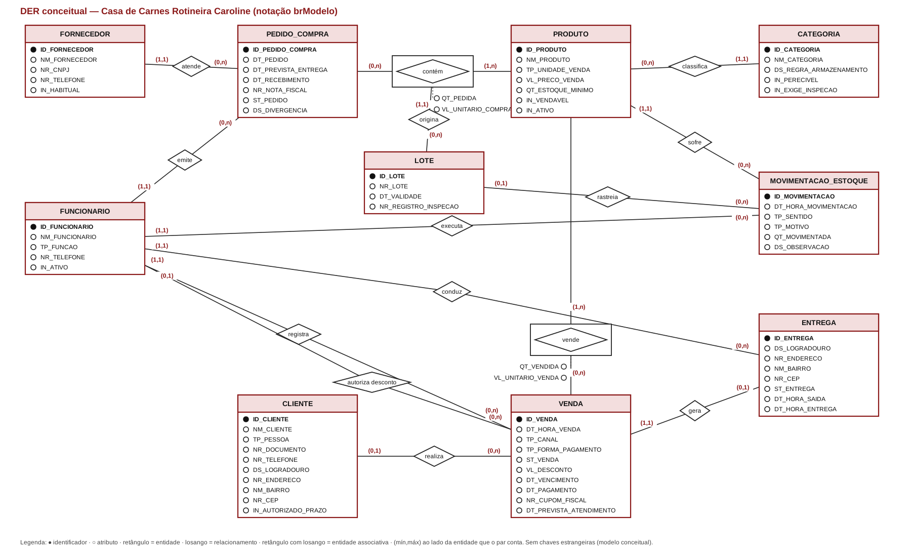
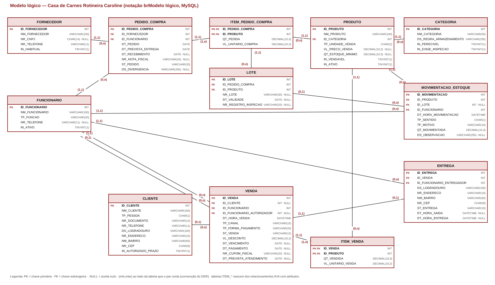

# Entrega 2 — Modelo Lógico, Implementação SQL e Apresentação Final
### Modelagem de um sistema de gestão de informações para uma organização de pequeno porte

> Organização real: **Casa de Carnes Rotineira Caroline** (açougue e casa de carnes). Banco: `acougue_caroline` · MySQL 8.0.16+ · versão 2.1 (03/11/2026). Turma de sexta-feira, 06/11/2026.

### Integrantes

| Nome completo do aluno | RGM | Usuário do GitHub |
| :---- | :---- | :---- |
| Gabriel Diniz Tavares da Costa | 48222721 | BielDCosta |
| Isaac Santos Alves da Costa | 48222852 | Dev-Isaacz |
| Paulo Henrique Fernandez Prado | 48100650 | PPrado07 |
| Rafael Aceiro Ferreira Gomes | 48225223 | Rafa-Aceiro |

### Mapa dos artefatos do repositório

| Artefato | Arquivo |
| :---- | :---- |
| Relatório técnico | este `README.md` |
| DER conceitual revisado (PNG e SVG) | [`DER_acougue.png`](./DER_acougue.png) · [`DER_acougue.svg`](./DER_acougue.svg) |
| Modelo lógico (PNG e SVG) | [`modelo_logico.png`](./modelo_logico.png) · [`modelo_logico.svg`](./modelo_logico.svg) |
| Dicionário de dados (HTML único) | [`dicionario_dados.html`](./dicionario_dados.html) |
| Script SQL único (CREATE DATABASE, tabelas, constraints, views, massa de dados e consultas) | [`script.sql`](./script.sql) |
| Levantamento de campo | [`levantamento/levantamento.md`](./levantamento/levantamento.md) |
| Fotos e evidências (JPG/PNG) | pasta [`evidencias/`](./evidencias/) |

**Software usado.** DER e modelo lógico seguem a notação do brModelo (retângulo = entidade, losango = relacionamento, círculo cheio = identificador, círculo vazio = atributo, retângulo envolvendo o losango = entidade associativa, par (mín,máx) nos dois lados). DER, modelo lógico, dicionário e SQL partem de uma mesma especificação do modelo, para os quatro artefatos não divergirem. O script foi testado do zero, em banco vazio.

---

## 1. Relatório Técnico Final

### 1.1 Revisão do Modelo Conceitual

#### Caracterização da organização

- **Nome e natureza:** Casa de Carnes Rotineira Caroline, comércio varejista de carnes (bovina, suína, aves), embutidos, congelados e mercearia. Com fins lucrativos, estabelecimento único, formalizado (CNPJ ativo), em funcionamento há mais de 15 anos.
- **Contexto e porte (números):** 13 pessoas — 1 proprietário, 5 açougueiros, 2 balconistas, 2 operadores de caixa, 1 ajudante geral, 1 entregador e 1 responsável administrativo-financeira. Funciona de segunda a sábado das 7h30 às 20h e aos domingos e feriados das 7h30 às 14h. Média de **300 a 400 vendas por dia** (cerca de 9 a 12 mil por mês), vendas no balcão, por telefone, WhatsApp e delivery. Compra carne bovina em peças grandes 1 a 2 vezes por semana, com prazo de entrega de 1 a 3 dias dos fornecedores.
- **Problemas e necessidades (P1–P6).** Cada um aparece no DER e tem consulta G no script (tabela de rastreabilidade, seção 1.6):
  - **P1** — Fornecedores não estão cadastrados no sistema; contatos ficam na agenda do celular do proprietário. *(DER: FORNECEDOR, PEDIDO_COMPRA; consultas G01, G02)*
  - **P2** — Controle de estoque só por contagem física; entradas de mercadoria não geram movimentação. *(DER: PRODUTO, LOTE, MOVIMENTACAO_ESTOQUE, ITEM_VENDA; consultas G03, G04)*
  - **P3** — Não existe estoque mínimo parametrizado; a reposição depende da experiência. *(DER: PRODUTO, MOVIMENTACAO_ESTOQUE, ITEM_VENDA; consultas G05)*
  - **P4** — As perdas de peso da desossa e do corte não são quantificadas. *(DER: PRODUTO, LOTE, MOVIMENTACAO_ESTOQUE; consultas G06, G07)*
  - **P5** — Vendas a prazo/fiado ficam em planilha e vias de papel; baixa e conciliação manuais. *(DER: VENDA, CLIENTE; consultas G08, G09, G10)*
  - **P6** — Sem rastreabilidade centralizada de lote e validade (dados só em etiquetas e embalagens). *(DER: LOTE, PEDIDO_COMPRA, MOVIMENTACAO_ESTOQUE; consultas G11, G12)*
- **Escopo do sistema:** o modelo cobre toda a operação — compras e fornecedores, produtos e categorias, lotes e validade, movimentação de estoque, desossa, vendas e itens, clientes, pagamentos a prazo, entregas e funcionários — e não apenas o estoque. O sistema que a loja já usa (cadastro de produtos, preços e caixa) continua; este banco incorpora o que hoje fica em planilha, agenda do celular e contagem visual.
- **Justificativa da escolha:** organização real, com processos específicos e ricos (desossa, validade, venda por peso, venda a prazo, delivery) que geram entidades e regras suficientes para um modelo completo, e com acesso direto ao proprietário. **Vínculo com a organização:** o proprietário, Ronaldo Ferreira Gomes, é tio do integrante Rafael Aceiro Ferreira Gomes. Esse vínculo facilitou o acesso ao estabelecimento e às explicações sobre o funcionamento do açougue, e é declarado aqui por transparência. O levantamento seguiu o fluxo descrito pelo proprietário, e o que não foi confirmado ficou registrado como hipótese.
- **Evidências:** Google Maps: https://share.google/IGnQx2U8OIvA5kZfN · WhatsApp (11) 96283-0823 · CNPJ ativo. Fotos do local (fachada, balcão e interior), tiradas na visita de 01/10/2026, em [`evidencias/`](./evidencias/).
- **Responsável pela organização:** **Ronaldo Ferreira Gomes** — proprietário — telefone **(11) 94743-9766**.

#### Relato da entrevista

- **Quando e onde:** a primeira visita foi em **12/09/2026**, no próprio estabelecimento, com o proprietário Ronaldo Ferreira Gomes, que explicou o funcionamento do açougue do começo ao fim, da entrada da nota fiscal ao pagamento do cliente (levantamento geral da Entrega 1). A segunda visita foi em **01/10/2026**, no estabelecimento, feita por Rafael Aceiro, para fotografar o local.
- **Comprovação:** fotos da visita na pasta [`evidencias/`](./evidencias/).
- **Fluxo explicado pelo proprietário:**
  1. **Compra:** pedido por telefone ou WhatsApp, às vezes comparando preços entre fornecedores. A carne bovina vem em peças grandes, 1 a 2 vezes por semana, com entrega em 1 a 3 dias.
  2. **Entrada da nota:** no recebimento, o açougueiro confere a nota fiscal com a mercadoria e anota data, número da nota e divergência. Lote, validade e registro de inspeção (SIF, SISP ou SIM) ficam só nas etiquetas e embalagens.
  3. **Armazenamento:** cada categoria tem sua regra (câmara fria, congelado, balcão refrigerado). O estoque é controlado por contagem visual, sem mínimo definido.
  4. **Desossa e corte:** os açougueiros desossam e cortam as peças; a perda de peso não é medida. Ossos, gordura e pele são separados e retirados todo dia por empresa especializada.
  5. **Venda:** o produto é pesado na balança e etiquetado; a venda é registrada no balcão, por telefone ou por WhatsApp. Há encomenda e entrega (delivery). Desconto só com autorização do proprietário.
  6. **Pagamento:** à vista (dinheiro, cartão, Pix etc.) ou a prazo. A prazo é boleto, que vence em 15 dias, ou fiado autorizado, quitado em até 30 dias. O pedido a prazo sai em 3 vias assinadas pelo cliente e a baixa é feita em planilha. CPF só é pedido quando há nota, boleto ou faturamento.
  7. **Fiscal:** toda venda concluída gera cupom ou documento fiscal.
- **Achados da observação presencial:** na visita de 01/10/2026 o grupo registrou em fotos a fachada, o balcão de atendimento e a área de exposição. Fechamento de caixa, cancelamento de venda e forma de anotar a entrega **não foram observados nem confirmados**; ficam como hipóteses (marcadas "a confirmar" no [levantamento](./levantamento/levantamento.md)) e fora do modelo.
- **Resumo do levantamento:** estoque controlado por contagem visual, sem saldo no sistema e sem mínimo; entradas de mercadoria não geram movimento; fornecedores só na agenda do proprietário; perdas da desossa não medidas; venda a prazo (boleto em 15 dias, fiado em até 30) controlada em planilha com 3 vias assinadas; validade só nas embalagens; descontos só com autorização do proprietário; CPF só quando há nota, boleto ou faturamento.

#### Processos de negócio

1. **Compra e recebimento** — Proprietário pede por telefone/WhatsApp, às vezes com cotação (`PEDIDO_COMPRA` + `ITEM_PEDIDO_COMPRA`); no recebimento o açougueiro confere a nota fiscal e anota data, NF e divergência. *(problemas: P1)*
2. **Recebimento com lote e validade** — Cada item recebido gera um ou mais `LOTE` com número do lote, validade e registro SIF/SISP/SIM. *(problemas: P6)*
3. **Movimentação de estoque** — Compra, desossa, descarte e ajuste entram em `MOVIMENTACAO_ESTOQUE` com produto, lote, funcionário, data/hora, sentido e quantidade. *(problemas: P2, P3)*
4. **Desossa e corte** — Peça sai do estoque (S, DESOSSA) e os cortes entram (E, DESOSSA) no mesmo lote; a perda é a diferença. *(problemas: P4)*
5. **Venda no balcão (peso e unidade)** — Pesagem na balança, itens, forma de pagamento, desconto autorizado, cupom fiscal. *(problemas: —)*
6. **Venda por telefone/WhatsApp e encomenda** — Encomenda aceita mesmo sem produto, com data prevista de atendimento. *(problemas: —)*
7. **Venda a prazo (boleto/fiado) e baixa** — Cliente autorizado e cadastrado, vencimento, 3 vias, baixa por data de pagamento. *(problemas: P5)*
8. **Entrega (delivery)** — Venda com entregador, endereço, horários de saída e entrega. *(problemas: —)*
9. **Descarte de resíduos e de produto vencido** — Resíduo retirado diariamente por empresa (fora do banco); descarte de produto entra como movimentação DESCARTE. *(problemas: P6)*

**Processos prováveis não incluídos — justificativa.** *Fechamento de caixa*, *pagamento a fornecedores* e *escala da equipe*: não foram mencionados na entrevista nem observados na visita de 01/10/2026; por isso ficam **fora** desta versão (marcados "a confirmar" no levantamento). *Programa de fidelidade*: a loja não tem. *Emissão de etiqueta e integração com a balança/cupom fiscal*: acontecem no sistema que a loja já usa; o banco guarda apenas o resultado (peso vendido, número do cupom).

#### Requisitos funcionais

- **RF01** — Cadastrar fornecedor com nome, CNPJ (opcional), telefone e indicador de fornecedor habitual. *(P1)*
- **RF02** — Registrar pedido de compra com fornecedor, funcionário responsável, data do pedido, data prevista de entrega e, para cada item, produto, quantidade e valor unitário. *(P1)*
- **RF03** — Registrar o recebimento do pedido com data, número da nota fiscal, situação (pendente, recebido, divergente, cancelado) e descrição da divergência. *(P1)*
- **RF04** — Cadastrar categoria com regra de armazenamento, indicador de perecível e indicador de exige inspeção sanitária. *(P6)*
- **RF05** — Cadastrar produto com nome, categoria, unidade de venda (KG/UN), preço de venda, estoque mínimo e indicadores de vendável e ativo. *(P3)*
- **RF06** — Registrar lote de cada item recebido com número do lote, data de validade e registro de inspeção (SIF, SISP ou SIM). *(P6)*
- **RF07** — Registrar movimentação de estoque com produto, lote, funcionário, data/hora, sentido (entrada/saída), motivo (compra, desossa, descarte, ajuste), quantidade e observação. *(P2, P4)*
- **RF08** — Consultar o saldo atual de cada produto (entradas − saídas − vendido). *(P2)*
- **RF09** — Apontar produtos abaixo do estoque mínimo e a quantidade a repor. *(P3)*
- **RF10** — Registrar desossa como saída da peça e entrada dos cortes no mesmo lote e apurar rendimento (%) e perda (kg) por lote. *(P4)*
- **RF11** — Registrar descarte de produto vencido ou avariado e totalizar por categoria, mês e fornecedor de origem. *(P6)*
- **RF12** — Cadastrar cliente com nome, tipo (pessoa física/jurídica), CPF/CNPJ, telefone, endereço (logradouro, número, bairro, CEP) e indicador de autorizado para venda a prazo. *(P5)*
- **RF13** — Registrar venda com data/hora, canal (balcão, telefone, WhatsApp), forma de pagamento, funcionário, cliente (obrigatório só a prazo), desconto com funcionário autorizador, número do cupom fiscal e, para cada item, produto, quantidade e preço unitário. *(P5)*
- **RF14** — Registrar venda a prazo (boleto ou fiado) com data de vencimento e dar baixa informando a data de pagamento. *(P5)*
- **RF15** — Registrar encomenda com data prevista de atendimento, mesmo sem produto em estoque. *(—)*
- **RF16** — Registrar entrega com venda, entregador, endereço, situação e horários de saída e de entrega. *(—)*
- **RF17** — Cadastrar funcionário com nome, função, telefone e situação (ativo/inativo). *(—)*
- **RF18** — Cancelar venda ou pedido por mudança de situação, sem apagar o registro. *(—)*
- **RF19** — Executar as consultas gerenciais (G01–G17) e de auditoria (A01–A17) do `script.sql`. *(P1–P6)*

#### Requisitos não funcionais

- **RNF01 — Usabilidade:** o registro de venda deve ser simples o bastante para balconista e caixa, sem atrasar a fila; a validação de regras fica no banco (CHECK), não em telas extras.
- **RNF02 — Desempenho:** índices nas colunas das consultas de maior volume (`IDX_VENDA_DT_HORA`, `IDX_VENDA_PRAZO`, `IDX_MOV_PRODUTO_DATA`, `IDX_LOTE_VALIDADE`, `IDX_PEDIDO_DT`) para sustentar 300 a 400 vendas por dia.
- **RNF03 — Integridade e confiabilidade:** InnoDB com chaves estrangeiras e CHECK; sem exclusão física de histórico (RN18).
- **RNF04 — Segurança e LGPD:** acesso por papel (matriz CRUD no dicionário, seção 9); dados pessoais restritos (RN17).
- **RNF05 — Disponibilidade:** banco disponível no horário de funcionamento (7h30–20h; 7h30–14h aos domingos); cópia de segurança diária fora do horário.
- **RNF06 — Portabilidade:** MySQL 8.0.16 ou superior, charset utf8mb4.

**Requisitos prováveis não incluídos:** integração com balança e emissão fiscal (feitas pelo sistema atual da loja); programa de fidelidade e cardápio/QR Code (a loja não tem).

#### Regras de negócio

Os códigos RN01–RN13 mantêm a numeração da Entrega 1; RN14–RN24 são novos. A coluna *Garantia* diz onde a regra é verificada: **BANCO** (restrição no SGBD), **AUDITORIA** (consulta A), **MISTA** (as duas) ou **FORA** (procedimento humano).

| Cód. | Regra | Garantia | Implementação |
| :---- | :---- | :---- | :---- |
| RN01 | Venda por peso só é registrada após a pesagem na balança; item por peso tem quantidade positiva e item por unidade tem quantidade inteira. | MISTA | CK em ITEM_VENDA (QT_VENDIDA > 0); A11 |
| RN02 | Venda a prazo (BOLETO ou FIADO) só para cliente previamente autorizado pelo proprietário e identificado na venda. | MISTA | CK_VENDA_PRAZO_EXIGE_CLIENTE; A01 |
| RN03 | Desconto só com autorização do proprietário; não há regra automática de desconto. | MISTA | CK_VENDA_DESCONTO_AUTORIZADO; A04 |
| RN04 | Encomenda pode ser registrada mesmo sem o produto em estoque, com data prevista de atendimento. | BANCO | CK_VENDA_ENCOMENDA_DATA |
| RN05 | Boleto vence em 15 dias; fiado autorizado é quitado em até 30 dias. | AUDITORIA | A05; CK_VENDA_DATAS (vencimento não anterior à venda) |
| RN06 | Toda venda a prazo emite 3 vias do pedido, assinadas pelo cliente na entrega ou retirada. | FORA | Procedimento em papel; comprovante físico. Sem coluna no banco. |
| RN07 | Peças de maior porte são desossadas/cortadas antes de serem vendidas como cortes; a desossa baixa a peça e dá entrada nos cortes, ambos no lote da peça; a diferença de peso é a perda. | MISTA | CK_MOV_LOTE_OBRIGATORIO; A12; G06 |
| RN08 | Resíduos da manipulação (ossos, gordura, pele) são separados e retirados diariamente por empresa especializada. | FORA | Processo de terceiro; a empresa mantém o registro da coleta. Sem entidade no banco (justificado na seção 1.1). |
| RN09 | O CPF/CNPJ só é exigido quando necessário (nota fiscal, boleto, faturamento); a venda de balcão pode não ter cliente. | BANCO | VENDA.ID_CLIENTE aceita NULL; CLIENTE só existe para quem exige cadastro |
| RN10 | Produto perecível exige controle de validade; cada categoria tem regra própria de armazenamento. | MISTA | CATEGORIA.DS_REGRA_ARMAZENAMENTO NOT NULL; A07; G11 |
| RN11 | Toda venda concluída tem cupom/documento fiscal emitido. | AUDITORIA | A09 |
| RN12 | Boleto/faturamento exige cadastro completo do cliente; apenas açougueiros desossam. | MISTA | Cadastro do cliente: NOT NULL e CK_CLIENTE_DOC_TAMANHO em CLIENTE; A06. Desossa só por açougueiro: procedimento interno, sem verificação no banco. |
| RN13 | A baixa de venda a prazo é registrada no sistema (e não mais em planilha). | BANCO | VENDA.DT_PAGAMENTO; G08, G09, G10 |
| RN14 | Cada produto pode ter estoque mínimo; abaixo dele o sistema aponta a necessidade de reposição. | BANCO | PRODUTO.QT_ESTOQUE_MINIMO; G05 |
| RN15 | No recebimento a nota fiscal é conferida; a divergência é descrita para ajuste da cobrança. | BANCO | CK_PEDIDO_RECEBIMENTO, CK_PEDIDO_DIVERGENCIA |
| RN16 | Produto de origem animal exige lote e registro de inspeção sanitária (SIF, SISP ou SIM) no recebimento. | AUDITORIA | A08 |
| RN17 | Dados pessoais (cliente, endereço de entrega, telefone de funcionário) têm acesso restrito por papel e finalidade (LGPD); a massa de testes é fictícia. | FORA | Papéis e permissões do dicionário (seção 9); privilégios GRANT por papel |
| RN18 | O histórico é preservado: pedidos, vendas, lotes e movimentações não são apagados — cancelam-se ou inativam-se. | BANCO | FKs sem CASCADE; ST_VENDA/ST_PEDIDO/IN_ATIVO; permissão DELETE só ao DBA |
| RN19 | Todo pedido de compra e toda venda têm ao menos um item. | AUDITORIA | A02, A03 (cardinalidade mínima 1 não é imposta por constraint no SGBD) |
| RN20 | Movimentação coerente: COMPRA só entra, DESCARTE só sai, e COMPRA/DESOSSA/DESCARTE exigem lote. | MISTA | CK_MOV_MOTIVO_SENTIDO, CK_MOV_LOTE_OBRIGATORIO; A10 |
| RN21 | Uma venda tem uma única forma de pagamento; vencimento só existe em boleto e fiado. | BANCO | CK_VENDA_PRAZO_EXIGE_CLIENTE, CK_VENDA_VENCIMENTO_SO_PRAZO |
| RN22 | Cada venda tem no máximo uma entrega, feita por funcionário de função ENTREGADOR, e só vendas por telefone/WhatsApp são entregues. | MISTA | UQ_ENTREGA_ID_VENDA; CK_ENTREGA_HORARIOS; A13 |
| RN23 | Saldo do produto = entradas − saídas (MOVIMENTACAO_ESTOQUE) − quantidades vendidas em vendas CONCLUIDAS (ITEM_VENDA); a venda não gera linha de movimentação e a encomenda só baixa o estoque quando concluída. | AUDITORIA | G03; A14 |
| RN24 | Só produto vendável (com preço) pode constar em venda. | MISTA | CK_PRODUTO_PRECO_VENDAVEL; A11 |

**Regras prováveis não incluídas:** troca/devolução e programa de fidelidade (a loja não opera); idade mínima (não se aplica); regras de fechamento de caixa (não confirmadas).

#### Notação do DER

DER em [`DER_acougue.png`](./DER_acougue.png), notação brModelo, **sem chaves estrangeiras**. As entidades associativas `contém` (PEDIDO_COMPRA × PRODUTO) e `vende` (VENDA × PRODUTO) têm atributos próprios e `contém` ainda se relaciona com LOTE. O par (mín,máx) fica **ao lado da entidade que ele conta** (quantas ocorrências dela se ligam a uma ocorrência da outra): em `FORNECEDOR (1,1) — atende — (0,n) PEDIDO_COMPRA`, um pedido tem exatamente um fornecedor e um fornecedor pode ter nenhum ou vários pedidos.

#### Caso A — mesma organização da Entrega 1

| Apontamento da correção da E1 | O que mudou no trabalho | Por quê |
| :---- | :---- | :---- |
| DER só com cardinalidade máxima | Todos os 14 relacionamentos têm (mín,máx) nos dois lados, com a convenção explicada acima | Sem o mínimo não se distingue participação obrigatória de opcional; ele decide NOT NULL na FK |
| Dicionário incompleto (relacionamentos, fluxo de dados, convenções, tipo físico/índices, log de acesso, papéis/LGPD) | Dicionário refeito com as 10 seções: convenções, entidades, relacionamentos (mín,máx), tabelas com expressão formal/tipo/obrigatoriedade/índice, domínios, 12 fluxos, regras RN, log de acesso, matriz CRUD, inventário LGPD | Atende ao modelo do exemplo de dicionário da disciplina |
| Processos sem fechamento de caixa | Registrado como processo provável não incluído, com justificativa | Não foi relatado na entrevista nem observado na visita; entra só se for confirmado |
| Regras sem SIF/lote e sem LGPD específica | Criadas RN16 (registro de inspeção por lote) e RN17 (dados pessoais com acesso restrito) | Exigência sanitária e legal do comércio de carne |
| Estoque, perdas e validade sem lugar no modelo (P2, P4, P6 sem tabela) | Criadas `LOTE` e `MOVIMENTACAO_ESTOQUE` (livro-razão único de estoque) | Todo problema declarado precisa aparecer no DER |
| Entrega (delivery) fora do modelo | Criada `ENTREGA` ligada a `VENDA` e ao funcionário entregador | O delivery é processo real da loja |
| FKs desenhadas no DER (feito na revisão anterior) | Mantidas fora do DER; só aparecem no modelo lógico | FK é decisão do modelo lógico |
| Seção de IA sem "trechos rejeitados" | Seção 6 preenchida com todos os campos | Exigência da disciplina |
| Entrevista sem data e foto; links quebrados; RGM do Rafael divergente | Datas das visitas (12/09 e 01/10/2026) e fotos registradas; links relativos para os arquivos na raiz do repositório; RGM corrigido para 48225223 | Evidência e rastreabilidade |

### 1.2 Conversão do Modelo Conceitual para o Modelo Lógico

- **Entidades → Tabelas:** cada entidade forte virou uma tabela com o mesmo nome (singular, maiúsculas): FUNCIONARIO, FORNECEDOR, CATEGORIA, CLIENTE, PRODUTO, PEDIDO_COMPRA, LOTE, MOVIMENTACAO_ESTOQUE, VENDA, ENTREGA. As duas entidades associativas viraram ITEM_PEDIDO_COMPRA e ITEM_VENDA.
- **Atributos → Colunas:** cada atributo virou coluna com tipo MySQL (VARCHAR, CHAR, INT, DECIMAL, DATE, DATETIME, TINYINT(1)); o identificador virou PK. Atributos de relacionamento (QT_PEDIDA, VL_UNITARIO_COMPRA, QT_VENDIDA, VL_UNITARIO_VENDA) foram para as tabelas associativas. Endereço foi quebrado em colunas atômicas (logradouro, número, bairro, CEP).
- **Relacionamentos → Chaves e cardinalidades:**

| Rel. | Relacionamento | (mín,máx) | Como foi convertido |
| :---- | :---- | :---- | :---- |
| R01 | FORNECEDOR **atende** PEDIDO_COMPRA | FORNECEDOR (1,1) · PEDIDO_COMPRA (0,n) | 1:N — a FK ID_FORNECEDOR fica em PEDIDO_COMPRA (lado N), NOT NULL porque o mínimo do lado FORNECEDOR é 1. |
| R02 | FUNCIONARIO **emite** PEDIDO_COMPRA | FUNCIONARIO (1,1) · PEDIDO_COMPRA (0,n) | 1:N — a FK ID_FUNCIONARIO fica em PEDIDO_COMPRA, NOT NULL (todo pedido tem quem o registrou). |
| R03 | PEDIDO_COMPRA **contém** PRODUTO | PEDIDO_COMPRA (0,n) · PRODUTO (1,n) | N:N com atributos — vira a tabela ITEM_PEDIDO_COMPRA (PK composta = as duas FKs) com QT_PEDIDA e VL_UNITARIO_COMPRA; é entidade associativa porque se relaciona com LOTE (R04). |
| R04 | ITEM_PEDIDO_COMPRA **origina** LOTE | ITEM_PEDIDO_COMPRA (1,1) · LOTE (0,n) | 1:N — FK composta (ID_PEDIDO_COMPRA, ID_PRODUTO) em LOTE referencia ITEM_PEDIDO_COMPRA; NOT NULL (todo lote vem de um item). |
| R05 | CATEGORIA **classifica** PRODUTO | CATEGORIA (1,1) · PRODUTO (0,n) | 1:N — a FK ID_CATEGORIA fica em PRODUTO, NOT NULL. |
| R06 | PRODUTO **sofre** MOVIMENTACAO_ESTOQUE | PRODUTO (1,1) · MOVIMENTACAO_ESTOQUE (0,n) | 1:N — a FK ID_PRODUTO fica em MOVIMENTACAO_ESTOQUE, NOT NULL. |
| R07 | LOTE **rastreia** MOVIMENTACAO_ESTOQUE | LOTE (0,1) · MOVIMENTACAO_ESTOQUE (0,n) | 1:N — a FK ID_LOTE fica em MOVIMENTACAO_ESTOQUE, NULL permitido (mínimo 0: o ajuste de contagem pode não ter lote). |
| R08 | FUNCIONARIO **executa** MOVIMENTACAO_ESTOQUE | FUNCIONARIO (1,1) · MOVIMENTACAO_ESTOQUE (0,n) | 1:N — a FK ID_FUNCIONARIO fica em MOVIMENTACAO_ESTOQUE, NOT NULL. |
| R09 | CLIENTE **realiza** VENDA | CLIENTE (0,1) · VENDA (0,n) | 1:N — a FK ID_CLIENTE fica em VENDA, NULL permitido (mínimo 0 do lado CLIENTE: venda de balcão sem identificação). |
| R10 | FUNCIONARIO **registra** VENDA | FUNCIONARIO (1,1) · VENDA (0,n) | 1:N — a FK ID_FUNCIONARIO fica em VENDA, NOT NULL. |
| R11 | FUNCIONARIO **autoriza** VENDA | FUNCIONARIO (0,1) · VENDA (0,n) | 1:N — a FK ID_FUNCIONARIO_AUTORIZADOR (papel nomeado, pois VENDA já tem ID_FUNCIONARIO) fica em VENDA, NULL permitido (só há autorizador quando há desconto). |
| R12 | VENDA **compõe** PRODUTO | VENDA (0,n) · PRODUTO (1,n) | N:N com atributos — vira a tabela ITEM_VENDA (PK composta = as duas FKs) com QT_VENDIDA e VL_UNITARIO_VENDA. |
| R13 | VENDA **gera** ENTREGA | VENDA (1,1) · ENTREGA (0,1) | 1:1 opcional — a FK ID_VENDA fica em ENTREGA (o lado que tem mínimo 1), NOT NULL e UNIQUE. |
| R14 | FUNCIONARIO **conduz** ENTREGA | FUNCIONARIO (1,1) · ENTREGA (0,n) | 1:N — a FK ID_FUNCIONARIO_ENTREGADOR (papel nomeado) fica em ENTREGA, NOT NULL. |

- **Generalização/especialização:** o DER não tem. A diferença entre pessoa física e jurídica em CLIENTE e entre funções em FUNCIONARIO é um atributo de tipo (`TP_PESSOA`, `TP_FUNCAO`), porque não há atributos nem relacionamentos exclusivos de cada subtipo.

### 1.3 Definição de Chaves Primárias e Estrangeiras

| Tabela | Chave primária | Chaves estrangeiras |
| :---- | :---- | :---- |
| FUNCIONARIO | ID_FUNCIONARIO | — |
| FORNECEDOR | ID_FORNECEDOR | — |
| CATEGORIA | ID_CATEGORIA | — |
| CLIENTE | ID_CLIENTE | — |
| PRODUTO | ID_PRODUTO | ID_CATEGORIA → CATEGORIA |
| PEDIDO_COMPRA | ID_PEDIDO_COMPRA | ID_FORNECEDOR → FORNECEDOR; ID_FUNCIONARIO → FUNCIONARIO |
| ITEM_PEDIDO_COMPRA | ID_PEDIDO_COMPRA, ID_PRODUTO | ID_PEDIDO_COMPRA → PEDIDO_COMPRA; ID_PRODUTO → PRODUTO |
| LOTE | ID_LOTE | (ID_PEDIDO_COMPRA, ID_PRODUTO) → ITEM_PEDIDO_COMPRA (ID_PEDIDO_COMPRA, ID_PRODUTO) |
| MOVIMENTACAO_ESTOQUE | ID_MOVIMENTACAO | ID_PRODUTO → PRODUTO; ID_LOTE → LOTE; ID_FUNCIONARIO → FUNCIONARIO |
| VENDA | ID_VENDA | ID_CLIENTE → CLIENTE; ID_FUNCIONARIO → FUNCIONARIO; ID_FUNCIONARIO_AUTORIZADOR → FUNCIONARIO |
| ITEM_VENDA | ID_VENDA, ID_PRODUTO | ID_VENDA → VENDA; ID_PRODUTO → PRODUTO |
| ENTREGA | ID_ENTREGA | ID_VENDA → VENDA; ID_FUNCIONARIO_ENTREGADOR → FUNCIONARIO |

### 1.4 Processo de Normalização (1FN, 2FN e 3FN)

Ponto de partida: a visão "plana" do que a loja anota hoje (pedido ao fornecedor, nota fiscal, ficha de venda, planilha de fiado).

- **1FN — atributos atômicos e sem grupos repetitivos.** (a) `tipo_produto_fornecido` do fornecedor era multivalorado na E1: saiu, e a ligação fornecedor–produto passa a ser dada pelos pedidos reais (`PEDIDO_COMPRA` → `ITEM_PEDIDO_COMPRA`). (b) A lista de produtos de um pedido de compra ou de uma venda é grupo repetitivo: virou linhas em `ITEM_PEDIDO_COMPRA` e `ITEM_VENDA`. (c) Endereço em um só campo foi dividido em logradouro, número, bairro e CEP. *Necessária porque:* sem ela não se soma, filtra nem ordena por produto e a venda ficaria limitada a um número fixo de itens.
- **2FN — sem dependência parcial da chave composta.** Nas tabelas de chave composta (`ITEM_PEDIDO_COMPRA` e `ITEM_VENDA`, PK = pedido/venda + produto), `NM_PRODUTO` dependia só de `ID_PRODUTO`: ficou em `PRODUTO`. Já `QT_PEDIDA`/`VL_UNITARIO_COMPRA` e `QT_VENDIDA`/`VL_UNITARIO_VENDA` dependem da chave inteira e ficam. O preço unitário fica no item de propósito: guarda o preço **praticado** na data, que difere do preço atual do produto. *Necessária porque:* o nome do produto repetido em cada item geraria divergência ao corrigir um nome.
- **3FN — sem dependência transitiva.** (a) Nome e telefone do fornecedor não ficam em `PEDIDO_COMPRA` (dependem de `ID_FORNECEDOR`). (b) Regra de armazenamento, perecível e exige inspeção dependem da categoria, não do produto: ficam em `CATEGORIA`. (c) Dados do cliente não ficam em `VENDA`. (d) O endereço de entrega fica em `ENTREGA` e não em `VENDA` (não depende da venda para vendas de balcão). (e) Valores derivados — total da venda, status de pagamento, saldo de estoque, perda de desossa — **não são colunas**: saem de `VW_TOTAL_VENDA`, de `DT_PAGAMENTO` (nulo = pendente) e de `VW_SALDO_ESTOQUE`, porque dependeriam de outras colunas e poderiam divergir (RN23). *Necessária porque:* o dado repetido por transitividade é exatamente o que gera anomalia de atualização.
- **Justificativa do conjunto:** o modelo chega à 3FN; as únicas repetições deliberadas são o preço unitário no item (histórico de preço praticado) e o endereço na entrega (histórico do local entregue, mesmo que o cliente mude de endereço).

### 1.5 Justificativas Técnicas das Decisões

**Chaves primárias.** Tabelas de entidade usam chave substituta `INT AUTO_INCREMENT` (`ID_<TABELA>`): CPF/CNPJ pode faltar (RN09), nome de produto muda e número de nota se repete entre fornecedores. Nas tabelas ITEM, a PK composta (pedido/venda + produto) impede o mesmo produto duas vezes no mesmo documento. `LOTE` tem PK própria e `UNIQUE (ID_PEDIDO_COMPRA, ID_PRODUTO, NR_LOTE)`.

**Chaves estrangeiras.** Cada uma das 14 FKs implementa um relacionamento da tabela da seção 1.2 (R01 a R14), onde estão a cardinalidade (mín,máx) e o motivo de cada NOT NULL ou NULL. A regra geral: mínimo 1 no lado referenciado vira `NOT NULL` na FK; mínimo 0 vira coluna que aceita `NULL`. Nas duas tabelas associativas, a PK composta é formada pelas duas FKs.

Não há `ON DELETE CASCADE` nem exclusão de histórico, porque a RN18 manda preservar o histórico (cancelamento é mudança de situação).

**Restrições aplicadas e as regras que implementam.**

| Restrição | Efeito | Regra |
| :---- | :---- | :---- |
| `CK_CLIENTE_DOC_TAMANHO` (CLIENTE) | CPF tem 11 dígitos e CNPJ tem 14, conforme TP_PESSOA. | RN12 |
| `CK_PRODUTO_PRECO_VENDAVEL` (PRODUTO) | Produto vendável precisa ter preço de venda. | RN24 |
| `CK_PEDIDO_DATAS` (PEDIDO_COMPRA) | A entrega prevista e o recebimento não podem ser anteriores ao pedido. | Integridade de domínio (sem RN específica) |
| `CK_PEDIDO_RECEBIMENTO` (PEDIDO_COMPRA) | Pedido recebido exige data de recebimento e número da nota fiscal. | RN15 |
| `CK_PEDIDO_DIVERGENCIA` (PEDIDO_COMPRA) | Recebimento com divergência exige a descrição da divergência. | RN15 |
| `CK_MOV_MOTIVO_SENTIDO` (MOVIMENTACAO_ESTOQUE) | COMPRA só entra (E); DESCARTE só sai (S). | RN20 |
| `CK_MOV_LOTE_OBRIGATORIO` (MOVIMENTACAO_ESTOQUE) | COMPRA, DESOSSA e DESCARTE exigem lote (rastreabilidade); só AJUSTE pode ficar sem. | RN20, RN07 |
| `CK_VENDA_PRAZO_EXIGE_CLIENTE` (VENDA) | Boleto e fiado exigem cliente identificado e data de vencimento. | RN02, RN21 |
| `CK_VENDA_VENCIMENTO_SO_PRAZO` (VENDA) | Só boleto e fiado têm vencimento. | RN21 |
| `CK_VENDA_DESCONTO_AUTORIZADO` (VENDA) | Desconto maior que zero exige funcionário autorizador. | RN03 |
| `CK_VENDA_ENCOMENDA_DATA` (VENDA) | Encomenda exige a data prevista de atendimento. | RN04 |
| `CK_VENDA_DATAS` (VENDA) | Vencimento e pagamento não podem ser anteriores à venda. | RN05, RN13 |
| `CK_ENTREGA_HORARIOS` (ENTREGA) | A entrega não pode ser anterior à saída. | RN22 |
| `CK_ENTREGA_ENTREGUE` (ENTREGA) | Entrega concluída exige o horário de recebimento. | RN22 |
| `NOT NULL` nas FKs com mínimo 1 | participação obrigatória do DER vira obrigatoriedade no banco | RN19, RN20 |
| `CHECK (... IN (...))` nas colunas ST_, TP_, IN_ | só valores do domínio | RN21, RN22 |
| `CHECK (QT_... > 0)` e `(VL_... >= 0)` | quantidade positiva e valor não negativo | RN01 |
| `CHECK REGEXP` em telefone, CEP, CNPJ, CPF | só dígitos e tamanho correto | Integridade de domínio (sem RN específica) |
| `UNIQUE (ID_VENDA)` em ENTREGA | no máximo uma entrega por venda | RN22 |
| Composite FK `FK_LOTE_ITEM` | lote nasce de um item de pedido real | Integridade referencial (R04) |

**Decisões arquiteturais gerais.**
1. **Livro-razão único de estoque:** todo movimento físico (compra, desossa, descarte, ajuste) é uma linha de `MOVIMENTACAO_ESTOQUE`; venda **não** é linha do livro, pois já está em `ITEM_VENDA` — gravar nos dois lugares duplicaria o dado (RN23). O saldo vem da view `VW_SALDO_ESTOQUE`.
2. **Perda de desossa derivada:** perda = kg da peça que saiu − kg dos cortes que entraram, por lote; não é coluna (G06, G07).
3. **Venda a prazo dentro de `VENDA`:** boleto e fiado são formas de pagamento; vencimento só existe nelas e `DT_PAGAMENTO` nulo significa pendente (RN05, RN13, RN21).
4. **Cliente opcional na venda:** venda de balcão não identifica o cliente (RN09); `CK_VENDA_PRAZO_EXIGE_CLIENTE` obriga o cliente quando é a prazo (RN02, RN12).
5. **Dois papéis de funcionário em venda e em entrega:** `ID_FUNCIONARIO` (quem vendeu) e `ID_FUNCIONARIO_AUTORIZADOR` (quem autorizou desconto); entregador separado em `ENTREGA`.
6. **Exclusão lógica:** nada é apagado; usa-se situação (RN18).

### 1.6 Proposta de Arquitetura Analítica para BI e IA

- **Informações estratégicas:** quais fornecedores entregam no prazo e com divergência; quanto se perde por desossa e por vencimento; o que repor e quando; quanto está a receber e há quantos dias; mix de produtos e faturamento por canal; custo do desconto concedido.
- **KPIs:** prazo médio de entrega do fornecedor (G02) · itens abaixo do mínimo (G05) · rendimento de desossa (G06) · valor vencido a receber (G09) · inadimplência (G10) · lotes a vencer em 7 dias (G11) · faturamento líquido (G13) · ticket médio por canal (G14) · mix de produtos / curva ABC (G15) · desconto concedido (G16) · tempo de entrega (G17). Cada KPI tem fórmula e período na própria consulta (mensal, semanal ou diário).
- **BI:** as views `VW_TOTAL_VENDA` e `VW_SALDO_ESTOQUE` e as consultas G alimentam um painel (Power BI, Metabase ou Looker Studio) direto no MySQL; datas e tipos separados em colunas facilitam agrupar por dia, semana e mês.
- **IA e análise preditiva:** previsão de demanda por produto e dia da semana (série de `ITEM_VENDA` por `DT_HORA_VENDA`) para sugerir quantidade de compra; sugestão automática de reposição cruzando saldo, mínimo e prazo do fornecedor (G02, G05); risco de inadimplência por cliente a partir do histórico de `DT_VENCIMENTO` × `DT_PAGAMENTO`; alerta de lote com saldo e validade curta para promoção; detecção de anomalias em descontos e em perda de desossa.

**Rastreabilidade — problema ou KPI → tabelas → consulta**

| Problema ou KPI | Tabelas envolvidas | Consulta no script |
| :---- | :---- | :---- |
| P1 — Fornecedores não estão cadastrados no sistema; contatos ficam na agenda do celular do proprietário. | FORNECEDOR, PEDIDO_COMPRA | G01, G02 |
| P2 — Controle de estoque só por contagem física; entradas de mercadoria não geram movimentação. | PRODUTO, LOTE, MOVIMENTACAO_ESTOQUE, ITEM_VENDA | G03, G04 |
| P3 — Não existe estoque mínimo parametrizado; a reposição depende da experiência. | PRODUTO, MOVIMENTACAO_ESTOQUE, ITEM_VENDA | G05 |
| P4 — As perdas de peso da desossa e do corte não são quantificadas. | PRODUTO, LOTE, MOVIMENTACAO_ESTOQUE | G06, G07 |
| P5 — Vendas a prazo/fiado ficam em planilha e vias de papel; baixa e conciliação manuais. | VENDA, CLIENTE | G08, G09, G10 |
| P6 — Sem rastreabilidade centralizada de lote e validade (dados só em etiquetas e embalagens). | LOTE, PEDIDO_COMPRA, MOVIMENTACAO_ESTOQUE | G11, G12 |
| KPI — prazo médio de entrega | FORNECEDOR, PEDIDO_COMPRA | G02 |
| KPI — itens abaixo do mínimo | PRODUTO, MOVIMENTACAO_ESTOQUE, ITEM_VENDA | G05 |
| KPI — rendimento de desossa | MOVIMENTACAO_ESTOQUE, LOTE, PRODUTO | G06 |
| KPI — valor vencido | VENDA, ITEM_VENDA, CLIENTE | G09 |
| KPI — inadimplência | VENDA, ITEM_VENDA | G10 |
| KPI — lotes a vencer | LOTE, PEDIDO_COMPRA, FORNECEDOR, MOVIMENTACAO_ESTOQUE | G11 |
| KPI — faturamento líquido | VENDA, ITEM_VENDA | G13 |
| KPI — ticket médio | VENDA, ITEM_VENDA | G14 |
| KPI — mix de produtos | ITEM_VENDA, PRODUTO, VENDA | G15 |
| KPI — desconto concedido | VENDA, FUNCIONARIO, ITEM_VENDA | G16 |
| KPI — tempo de entrega | ENTREGA, VENDA | G17 |

---

## 2. Modelo Lógico Relacional

Diagrama: [`modelo_logico.png`](./modelo_logico.png) (SVG em [`modelo_logico.svg`](./modelo_logico.svg)), na notação lógica do brModelo (tabela, coluna com tipo, PK, FK, ligação com (mín,máx)). `NOT NULL`, `UNIQUE`, `CHECK` e `DEFAULT` estão no [dicionário de dados](./dicionario_dados.html) e implementados no [script](./script.sql).

## 3. Script SQL Completo

Arquivo único: [`script.sql`](./script.sql). Ele reúne, nesta ordem:

- `CREATE DATABASE` e `CREATE TABLE` com PK/FK/NOT NULL/UNIQUE/CHECK/DEFAULT, índices e as duas views;
- `INSERT INTO` da massa de dados fictícia (seção 4);
- consultas gerenciais **G01–G17** e de auditoria **A01–A17**, cada uma com cabeçalho (`-- Gnn — pergunta` / `-- Atende: Pn` ou `-- Verifica: RNnn`). As consultas G/A cruzam várias tabelas com `JOIN`; ao final há `UPDATE` (U01, U02) e `DELETE` (D01) de demonstração.

O script recria o banco do zero, então basta executá-lo de uma vez. Testado do zero em banco vazio: criação, massa e consultas rodam sem erro.

## 4. Massa de Dados

Fica dentro do [`script.sql`](./script.sql), logo após a criação das tabelas. **Fictícia**: nomes, telefones (`119000xxxx`), CNPJ e CPF inventados; nenhum dado real da loja (LGPD, RN17). Período simulado: compras desde 28/09/2026 e vendas de 05/10 a 04/11/2026 (30 dias).

**Como o volume real justifica a quantidade de registros.** A loja faz 300 a 400 vendas por dia (9 a 12 mil por mês). A massa é uma **amostra de cerca de 1% do movimento mensal** — 85 vendas em 30 dias (2 a 4 por dia) —, suficiente para que cada consulta G e A mostre resultado sem tornar o teste inviável em sala. As demais tabelas seguem a rotina informada: compra de peças bovinas 1 a 2 vezes por semana, frango toda semana e suíno/embutidos a cada 15 dias.

| Tabela | Registros | Por quê |
| :---- | :---- | :---- |
| FUNCIONARIO | 13 | a equipe inteira informada (1+5+2+2+1+1+1) |
| FORNECEDOR | 7 | 5 habituais + 2 eventuais (G02 calcula prazo e pedidos recentes) |
| CATEGORIA | 7 | bovino, suíno, aves, embutidos, congelados, mercearia, bebidas |
| PRODUTO | 25 | 2 peças (não vendáveis, matéria-prima da desossa), 23 vendáveis por kg e por unidade — amostra do catálogo |
| CLIENTE | 14 | 4 pessoas jurídicas e 10 físicas; 8 autorizados a prazo, 5 sem nenhuma compra |
| PEDIDO_COMPRA / ITEM | 28 / 67 | ~5 semanas de compras; 1 recebido com divergência, 1 pendente, 1 cancelado |
| LOTE | 63 | 1 lote por item recebido |
| MOVIMENTACAO_ESTOQUE | 134 | compras, 60 movimentos de desossa (peça sai, cortes entram), descartes por vencimento e ajustes de contagem |
| VENDA / ITEM_VENDA | 85 / 208 | 3 canais, 8 formas de pagamento, 18 a prazo (boleto/fiado, pagos, em aberto e vencidos), 11 com desconto, 7 canceladas, 1 encomenda |
| ENTREGA | 14 | vendas por telefone/WhatsApp com cliente identificado |

**Situações cobertas:** pedido cancelado e divergente; cliente sem compra; produtos abaixo do estoque mínimo (G05 lista 5); fiado/boleto pago no prazo, pago em atraso, em aberto e vencido; todas as formas de pagamento; lotes a vencer nos próximos 7 dias (G11) e descarte por vencimento; desossa com perda por lote (G06, G07). **Inconformidades propositais** para as auditorias terem o que mostrar: **A07** (lote perecível sem validade), **A09** (venda concluída sem cupom) e **A16** (pedido recebido sem lote).

**Atenção à data de execução.** As consultas G02, G09 e G11 usam `CURDATE()` e a massa termina em 04/11/2026; os resultados descritos neste relatório valem para execução por volta de **06/11/2026**. Em outra data, os números dessas consultas mudam.

**Uso de LLM:** a massa foi gerada por um script (Python, semente fixa) escrito com apoio do Claude — ver seção 6.

## 5. Repositório GitHub

Conteúdo na `main`: README, dicionário HTML, DER, modelo lógico, scripts, levantamento, evidências. Commits distribuídos entre as quatro contas (BielDCosta, Dev-Isaacz, PPrado07, Rafa-Aceiro), cada um com a própria conta.

## 6. Uso de Inteligência Artificial

| Item | Registro |
| :---- | :---- |
| **Ferramenta e etapa** | Claude (Anthropic): (1) E1 — organização do levantamento no README e primeiro DER; (2) E1 revisão — ajuste do modelo conforme correção; (3) E2 — análise da correção da E1, revisão do DER com (mín,máx), criação de `LOTE`, `MOVIMENTACAO_ESTOQUE` e `ENTREGA`, conversão para o lógico, normalização, dicionário de dados, script SQL, massa de dados e consultas G/A, redação e revisão deste relatório. |
| **Motivação** | Prazo curto (entrega em 06/11), volume de artefatos e necessidade de manter DER, lógico, dicionário e SQL coerentes entre si. |
| **Prompt(s) utilizados** | "analise toda correção do professor e pontue aquilo que a gente precisa alterar"; "analise o esqueleto da entrega dois e veja o que é necessário entregar"; "faça e revise toda essa parte da modelagem … topo as entidades novas apenas se estiverem corretas com o enunciado". |
| **Resposta recebida** | Lista priorizada de correções; modelo com 12 tabelas; DER e lógico em imagem; dicionário em HTML; script MySQL, massa de dados (script gerador com semente fixa) e 34 consultas (G01–G17, A01–A17); rascunho deste README. |
| **Fontes consultadas e verificadas** | Esqueleto da Entrega 2, slides e exemplo de dicionário, laboratório de cardinalidade do professor, correção da E1 e o relato do proprietário nas visitas. As regras foram conferidas contra esse relato; as não confirmadas ficaram como hipóteses. O script foi executado em banco vazio (MariaDB 10.x) e, na revisão v2.1, também em MySQL 8.0.46 (script, massa e todas as consultas sem erro). |
| **Trechos rejeitados ou corrigidos** | (1) O RGM do Rafael, que a IA reaproveitou da E1, estava errado e foi corrigido para 48225223. (2) A primeira versão do DER escondia os pares (mín,máx) atrás dos losangos; foi redesenhada com o par ao lado da entidade que ele conta. (3) A IA propôs `LOTE`, `MOVIMENTACAO_ESTOQUE` e `ENTREGA`; o grupo só aceitou as entidades que respondem a um problema declarado na entrevista (P2, P4, P6 e o delivery). (4) Fechamento de caixa e pagamento a fornecedores foram retirados do modelo por não terem sido relatados nem confirmados. (5) Emissão de etiqueta e integração com balança e cupom fiscal ficaram fora do banco, pois já são feitas pelo sistema que a loja usa. |
| **Justificativa da escolha final** | Manteve-se o livro-razão único de estoque (`MOVIMENTACAO_ESTOQUE`) por três motivos: evita dado duplicado, já que a venda fica só em `ITEM_VENDA` (RN23); responde P2, P4 e P6 com uma única tabela; e o saldo é calculado por view, não guardado em coluna, o que impede divergência entre o registrado e o real. As demais decisões seguem a mesma lógica: só entrou no modelo o que resolve um problema relatado pelo proprietário. |
| **Reflexão crítica** | A IA não visitou a loja: regras marcadas "a confirmar" (cancelamento, entrega, fechamento de caixa) são hipóteses. A massa foi gerada por script e é uma amostra (~1%) do movimento real; o grupo deve ser capaz de explicar a proporção e reproduzir o script. A IA pode errar convenção de cardinalidade — por isso a regra foi conferida com o laboratório do professor. Os diagramas foram produzidos por código e não abertos no brModelo; o grupo deve conseguir explicar qualquer elemento na defesa. |

## 7. Apresentação Corporativa Final

Roteiro de 8 minutos: (1) problema: estoque, perdas, validade e fiado fora do sistema; (2) solução: 12 tabelas em 3FN; (3) modelo lógico; (4) `script.sql` rodando; (5) demonstração de G05, G06, G09, G11 e A09; (6) BI e IA; (7) benefícios: menos perda, reposição no tempo certo, cobrança em dia, rastreio de lote.
